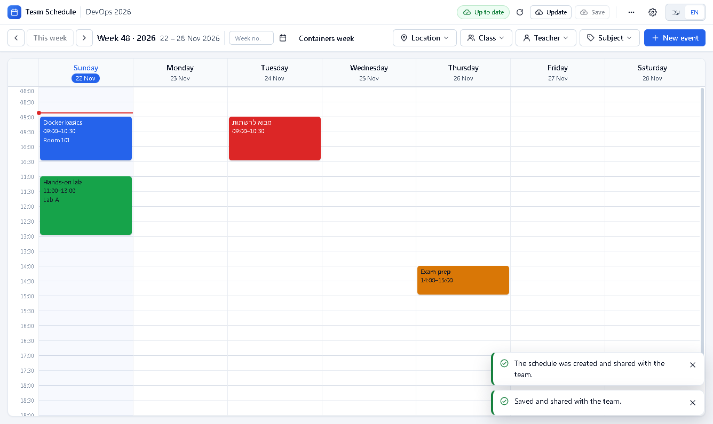
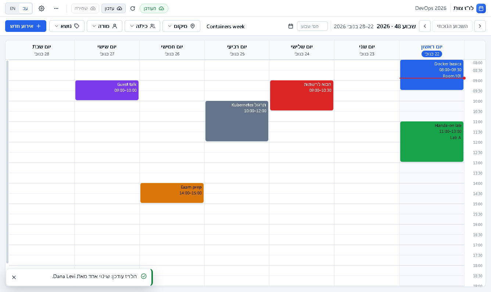
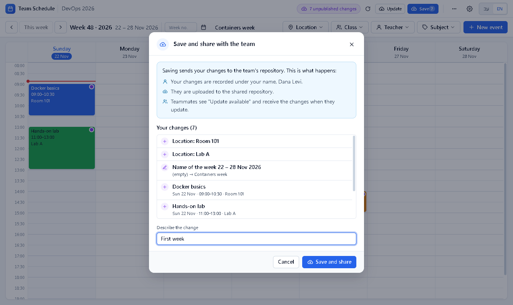
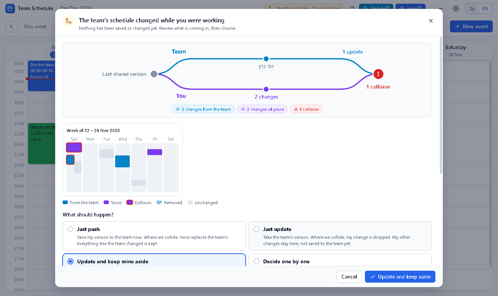
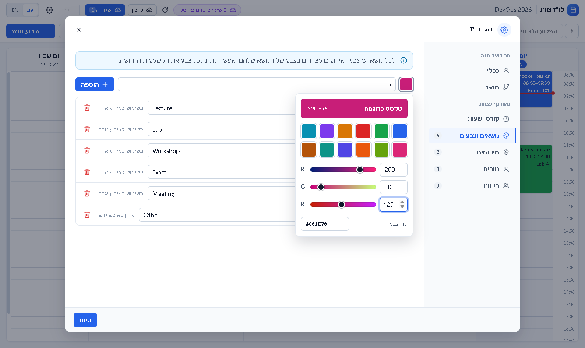
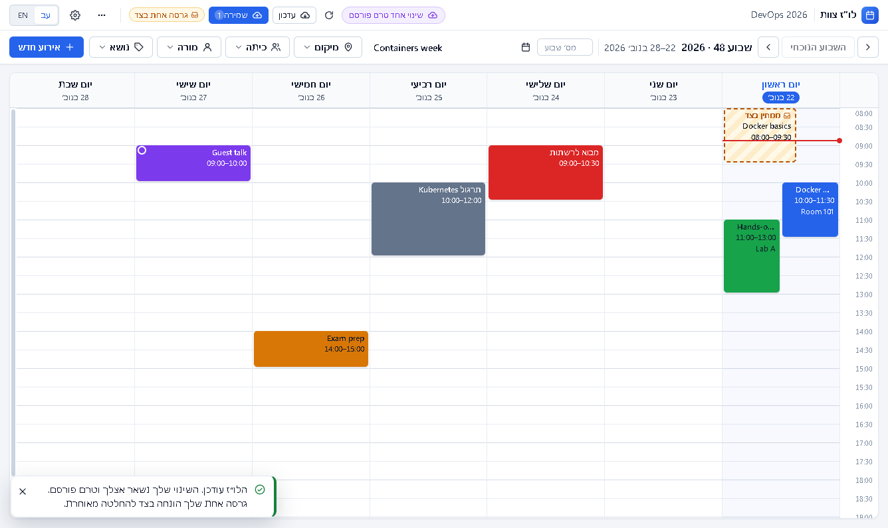
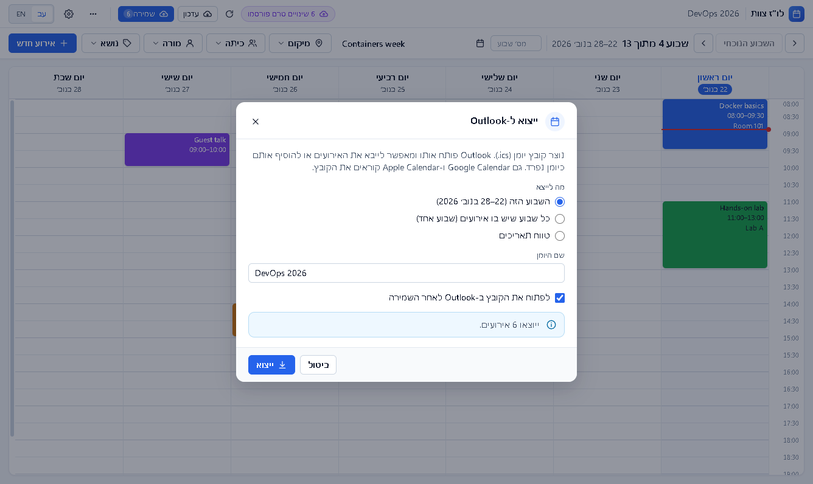

# Team Schedule · לו״ז צוות

A Windows desktop app for a team that plans its week together. Everyone creates, edits and
views the same **weekly schedule** (Sunday → Saturday) in **Hebrew or English**, with a
fully mirrored right-to-left layout for Hebrew.

There is **no server**. The schedule lives in a git repository that the team shares (on
GitHub, GitLab, or simply a folder on a shared drive). Each computer keeps its own copy;
**Save** sends your changes to the team and **Update** brings in theirs.



| Hebrew, right to left | Saving asks first and says what it means |
| --- | --- |
|  |  |

| When two people changed the same thing | Subjects are named RGB colours |
| --- | --- |
|  |  |

| "Kept aside": my version waits next to the team's | Export to Outlook |
| --- | --- |
|  |  |

## What it does

- **Weekly schedule** – events with a time, title, subject, location, teachers, classes and
  notes. Click a time slot to add one, drag across slots for a longer one, drag an event to
  move it, drag its lower edge to change its length. Undo / redo with `Ctrl+Z` / `Ctrl+Y`.
- **Hebrew and English** – switch any time with the `עב | EN` button; names you type may be
  in either language.
- **Shared through git** – a status bar in the toolbar always shows where you stand:

  | Status | Meaning | What to do |
  | --- | --- | --- |
  | ✓ Up to date | You and the team have the same schedule | – |
  | ↑ N unpublished changes | You changed things the team cannot see yet | **Save** |
  | ↓ N updates available | A teammate published changes | **Update** |
  | Update available · N unpublished | Both of the above | **Save** or **Update** – the app shows a merge overview |
  | Offline / Sign-in needed | The repository cannot be reached | Check the network, or sign in |

- **Save with a confirmation** – before anything leaves your computer you see what saving
  means and the exact list of changes. Teammates get a toast, a Windows notification and an
  "update available" status within a minute.
- **A graphic merge overview** – if the team's schedule changed while you were working, you
  see a picture of both lines of work, a mini week map of who changed what, and every
  collision side by side. Then you choose:
  - **Just push** – your version wins where you collide; everything else the team changed is kept.
  - **Just update** – the team's version wins; your other changes stay on your computer, unpublished.
  - **Update and keep mine aside** – the team's version goes into the schedule and yours
    stays next to it as a dashed "kept aside" event, to decide later.
  - or decide **one by one**.
- **Who changed what** – every event shows who last edited it and when. This comes from the
  git history ("git blame"), compared event by event: adding or removing a lesson next to
  another one does not change who "last edited" that other one.
- **Filters** – show the whole week for one location, class, teacher or subject.
- **Lists you manage** – locations, teachers, classes, and subjects. A subject is a colour
  with a name: pick any RGB colour and call it what you need.
- **Time layout** – day start, day end and the row length (15 / 30 / 45 / 60 minutes) are
  settings; times snap to 15 minutes.
- **Weeks** – name each week, move with the arrows or jump by **week number**. With a course
  start date the weeks are numbered from the first week of the course ("Week 4 of 13").
- **Repeat** – copy a week into the following weeks, or save it to a **week file** and load
  it again later (even into another team's schedule). A week file always holds the whole
  week, whatever filter is on. A file from elsewhere is held to the rules of the editor when
  it is loaded: times land on the quarter hour and over-long texts are cut, and the app says so.
- **Keyboard** – everything works without the mouse: `Tab` and the arrow keys move, `Enter`
  opens an event, `Delete` removes it (with *Undo*), `Ctrl+S` saves to the team,
  `PageUp` / `PageDown` change the week, `Esc` closes (in an event you have changed it asks
  first).
- **Outlook** – export a week, a date range or the whole course to an `.ics` calendar file
  that Outlook, Google Calendar and Apple Calendar open.

## Getting started (for the team)

### 1. Each computer needs

- Windows 10 or 11
- [Git for Windows](https://git-scm.com/download/win) (the app uses it to talk to the
  repository; sign-in is handled by Git's own credential window)
- Team Schedule itself: the installer `TeamSchedule-Setup-1.0.2.exe`, or the single-file
  `TeamSchedule-Portable-1.0.2.exe` that needs no installation. Both are built from this
  repository with one command (see [For developers](#for-developers)) and land in `dist\`;
  hand them to the team any way you like. The files are not signed, so Windows SmartScreen
  may ask once: choose *More info → Run anyway*.

### 2. One shared repository

Any empty git repository that the whole team can reach works. Two common choices:

- **GitHub / GitLab** – create an empty private repository and give the team write access.
  The address looks like `https://github.com/your-team/schedule.git`.
- **A shared folder** – no account needed. In a folder everyone can write to, run once:

  ```powershell
  git init --bare \\server\share\schedule.git
  ```

  The address is then `\\server\share\schedule.git`. If Git refuses the folder because it
  belongs to another Windows user, the app explains it and offers a *Trust this folder* button.

### 3. First start

1. Choose the language, paste the repository address, enter your name and e-mail (they are
   shown to teammates next to your changes) and press **Connect**. (*Advanced → Branch* is
   only for a team that keeps several schedules in one repository. A branch name the
   repository does not have is refused and the existing ones are listed, so a typing
   mistake cannot quietly split you off from the team.)
2. The first person is offered to **create the schedule** (course name and, optionally, the
   course start and end dates). Everybody after that just connects and sees it.
3. Open **Settings** to add locations, teachers, classes and subjects, and to set the hours
   of the day. These settings are part of the schedule and are shared with the next Save.

## How the schedule is stored

The repository contains plain, readable files:

```
schedule.json            course dates, hours of the day, subjects, locations, teachers, classes
weeks/2026-11-22.json    one file per week, named after its Sunday, one event per line
```

One event per line keeps the history readable in any git tool. For "who last edited this
event" the app compares the versions of a week event by event; a line-based `git blame`
would also name whoever merely added the next line. The app never lets git merge text: it compares
the three versions (last shared, yours, the team's) event by event and field by field, so
two people editing different events — or different fields of the same event — never collide.

Things that stay on your computer only: your language, name, the repository address, and
the versions "kept aside". They are stored in `%APPDATA%\Team Schedule`.

### Nobody's work gets lost

- Changes are written to your computer as you make them; closing the app with unpublished
  changes asks first, and they are still there the next time you open it.
- **Save** never overwrites a teammate: if the team's schedule moved in the meantime — even
  in the second between your click and the upload — the save is taken back, the merge
  overview appears, and your work stays unpublished until you decide.
- A version you did not choose in a collision is not thrown away unless you say so: "keep
  aside" stores it on your computer and shows it on the grid until you apply or discard it.
- A schedule file the app cannot read (damaged, written by a newer version, or saved by
  another program in another text encoding) is never rewritten, deleted or published: it is
  kept byte for byte. The week is shown as the team has it and is locked for editing;
  *Restore the team's version* repairs a file that was damaged on your computer.
- What you confirm is exactly what happens. Once a save or a merge decision is confirmed,
  the window is busy until it is done; and a decision made on an overview that has gone out
  of date is not applied — the overview is drawn again.
- Closing the window over a half-written event asks first, and *Go back* returns to it as
  it was. So does `Esc` in an event you have changed.
- If somebody undoes a save on the server (moves the branch back), the other computers see
  an update to follow — not "unpublished changes" that would publish the mistake again.
- Two people who add the same room, teacher or class end up with one entry, not two: on
  the next update yours is folded into the team's, and your lessons point to it.

## Troubleshooting

| Problem | What to do |
| --- | --- |
| "Git is not installed" | Install Git for Windows, then press *Check again* (or *Locate git.exe…*). |
| "Sign-in needed" | Press *Sign in* / the refresh button; Git's credential window opens. |
| "Git does not trust the repository folder" | Normal for shared folders owned by a colleague, and for the app's own data folder after it was copied from another computer or restored from a backup: press *Trust this folder*. Nothing is moved or cloned again; your unpublished changes stay where they are. |
| "This repository has no branch with that name" | The name under *Advanced → Branch* was mistyped (the message lists the branches that exist): correct it, or clear the field to use the repository's own branch. *Create this branch* is only for a second, separate schedule. |
| "Git did not finish in time and was stopped" | A save, update or sign-in that takes longer than three minutes is stopped so the app never hangs. Nothing is lost: press the button again. |
| "Some schedule files could not be read" | The file was damaged on this computer: press *Restore the team's version* in the warning bar (unpublished changes on this computer are discarded with it). |
| "Saved by a newer version" | A teammate uses a newer Team Schedule: install the latest version of the app. |
| "The team's branch no longer exists on the server" | Someone deleted or renamed the branch. **Save** creates it again from your copy. If the team moved to another branch on purpose, enter the repository address again in *Settings → Repository*: the app then follows the repository's default branch. |
| The status stays "Checking…" or "Offline" | The repository cannot be reached (network, VPN, shared drive). Your work is kept; press the refresh button when the connection is back. |
| Windows SmartScreen warning | The app is not code-signed: *More info → Run anyway*. |

## For developers

Electron 45 · React 19 · TypeScript 7 · electron-vite · Vitest · Playwright.

```
src/shared/      pure logic shared by both sides: file format, merge engine, dates, .ics, week files
src/main/        Electron main process: window, bridge, local settings, and src/main/git (drives git.exe)
src/preload/     the single bridge object exposed to the page (window.api)
src/renderer/    the React interface: store (state + sync flows), components, translations (en / he)
tests/unit         pure logic                      tests/integration   the git layer against real repositories
tests/renderer     the store with a fake bridge    tests/e2e           the built app, driven by Playwright
```

Node.js 22.12 or newer and Git are required. With Node installed normally, use plain `npm`.
`npmw.cmd` is for a machine without Node: it runs npm from a portable Node.js unpacked into
`.tools\node` (that folder is not committed).

```powershell
npm install            # once; if npm skipped Electron's download: node node_modules\electron\install.js
npm run dev            # run with hot reload
npm run typecheck
npm test               # ~3,590 unit, git-integration and store tests (the integration tests need git)
npm run build          # production build into out\
npm run test:e2e       # end-to-end tests: Playwright drives the built app (run the build first)
npm run dist           # build + installer and portable exe into dist\
```

To run the end-to-end tests against the packaged app instead of the build in `out\`, set
`TEAM_SCHEDULE_EXE` to `dist\win-unpacked\Team Schedule.exe` first. The tests leave
screenshots of every screen in `test-results\screens` (the ones in this README come from there).

Design notes worth knowing before changing things:

- **`src/shared/api.ts` is the contract** between the page and the main process. The page
  is sandboxed (no Node, context isolation, a strict content security policy, no navigation,
  no new windows) and can do nothing else; every argument is validated again in
  `src/main/validate.ts`. Git is always started directly with an argument list — never
  through a shell — and only `schedule.json` and `weeks/*.json` are ever written or committed.
- **The local branch never keeps commits the team does not have.** Unpublished work is just
  modified files in the working folder (`%APPDATA%\Team Schedule\repos\…`). Publishing is:
  fetch → verify the team's tip is the one the merge was made against → write files → commit
  → push; if the push does not go through, the commit is undone and the work stays unpublished.
  The commit this computer last agreed on with the team is remembered in
  `refs/team-schedule/synced`; that is how a branch that was moved back on the server is told
  apart from a local commit that never went out.
- **Two queues in `src/main/git/repoService.ts`**: work in the working folder never runs in
  parallel, and neither do network commands — but a fetch that waits for a silent server
  does not block writing edits to disk.
- **git is never left hanging, and never leaves the clone unusable.** Every command has a
  time limit; a check for updates that is still waiting two seconds after the window was
  closed is ended, so the app can be opened again at once (a save always runs to its end).
  A git that is ended by force — or that died in a crash — can leave lock files behind
  (on the index, HEAD, the branches, `packed-refs`, the configuration): these are cleared on
  the spot or by the next command, after a two-second wait that a git at work never needs.
- **File contents are never decoded lossily.** A data file that is not UTF-8 crosses the
  bridge as its bytes (`RAW_BYTES_PREFIX`), is reported as unreadable, and is written back
  unchanged.
- **Selectors must return stable references** (`useApp` is `useSyncExternalStore`): select a
  piece of state as it is and derive from it with `useMemo`.
- **Right-to-left**: only logical CSS properties (`margin-inline-start`, …); user text keeps
  its own direction with `<bdi>` / `dir="auto"`; times and ranges are always left-to-right.
  Sentences of the interface keep the interface's direction: every name or value that the
  translator (`i18n/index.ts`) puts into a sentence is wrapped in Unicode isolates, so a
  room called "Room A" cannot turn a Hebrew sentence around. Compare such texts in tests
  with `withoutIsolates()`.

## License

[MIT](LICENSE) — use it, change it and pass it on, as long as the copyright notice and the
license text stay with it. It comes without any warranty.

---

## מדריך קצר בעברית

**לו״ז צוות** היא תוכנה ל-Windows לניהול לו״ז שבועי משותף (ראשון עד שבת) בעברית או באנגלית.
אין שרת: הלו״ז שמור במאגר git שהצוות משתף (GitHub, GitLab או תיקייה משותפת), ובכל מחשב יש עותק.

1. **התקנה** – מתקינים [Git for Windows](https://git-scm.com/download/win) ואת התוכנה
   (`TeamSchedule-Setup` או הגרסה הניידת `TeamSchedule-Portable`).
2. **התחברות** – בהפעלה הראשונה בוחרים שפה, מדביקים את כתובת המאגר, מזינים שם ודוא״ל ולוחצים
   ״התחברות״. הראשון בצוות יוצר את הלו״ז; כל השאר פשוט מתחברים.
3. **עבודה** – לחיצה על משבצת זמן מוסיפה אירוע; גרירה מזיזה או מאריכה אותו. השינויים נשמרים
   במחשב שלך עד ללחיצה על **שמירה**, שמציגה מה יישלח ומבקשת אישור.
4. **סרגל המצב** – ״מעודכן״, ״N שינויים טרם פורסמו״ (ללחוץ שמירה) או ״יש עדכון״ (ללחוץ עדכון).
5. **התנגשות** – אם חבר צוות שינה את אותו אירוע, מוצגת סקירה גרפית עם שלוש אפשרויות:
   **רק לשמור** (הגרסה שלי גוברת), **רק לעדכן** (הגרסה של הצוות גוברת), או **לעדכן ולשמור את שלי
   בצד** – הגרסה שלי נשארת על הלו״ז כאירוע מקווקו עד שמחליטים.
6. **עוד** – סינון לפי מיקום / כיתה / מורה / נושא, מתן שם לשבוע, מעבר לפי מספר שבוע, שכפול
   שבוע, שמירה וטעינה של שבוע מקובץ, וייצוא ל-Outlook (קובץ ‎.ics).
7. **הגדרות** – תאריכי תחילת וסיום הקורס, שעות היום ואורך שורה (15–60 דקות), ורשימות של
   מיקומים, מורים, כיתות ונושאים (לכל נושא צבע RGB ושם).
8. **שום עבודה לא הולכת לאיבוד** – השינויים נכתבים למחשב תוך כדי עבודה; שמירה לעולם אינה דורסת
   שינויים של הצוות; וקובץ לו״ז שלא ניתן לקרוא אינו נמחק ואינו נשלח – אפשר לשחזר אותו בלחיצה
   על ״שחזור הגרסה של הצוות״. סגירת החלון באמצע כתיבת אירוע שואלת קודם, ו״חזרה״ מחזירה אליו כמו שהיה.
9. **מקלדת** – אפשר לעבוד בלי עכבר: Tab וחיצים לתנועה, Enter פותח אירוע, Delete מוחק (עם ״ביטול״),
   Ctrl+S שומר לצוות, PageUp / PageDown מחליפים שבוע, ו-Esc סוגר.

**רישיון** – [MIT](LICENSE): מותר להשתמש, לשנות ולהפיץ, כל עוד הודעת זכויות היוצרים ונוסח הרישיון נשארים עם התוכנה. אין אחריות.
